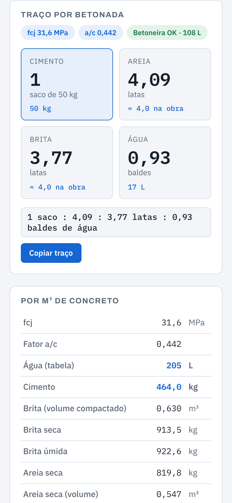
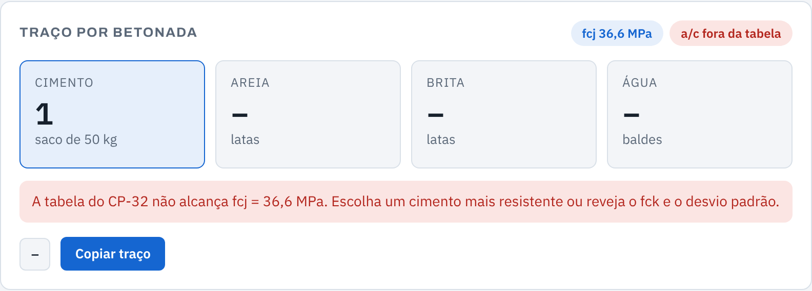
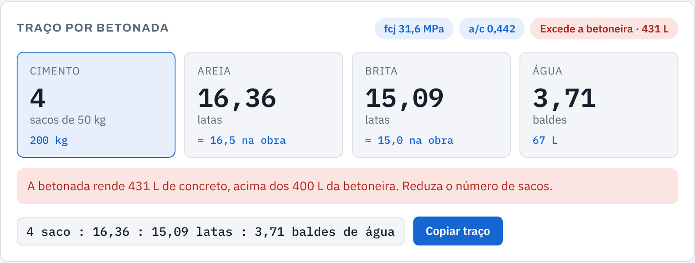
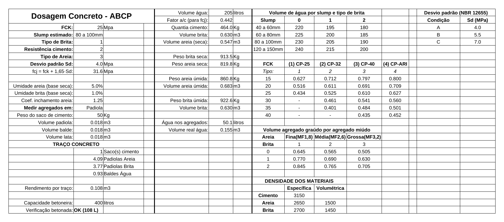

# Dosagem de Concreto · Método ABCP

**Do fck ao traço da betoneira em segundos: sacos de cimento, latas de areia e brita e baldes de água, já com correção de umidade e inchamento da areia.**

---

## O que ele resolve

Dosar concreto pelo método da ABCP envolve várias tabelas, conversões entre volumes absolutos e aparentes e correções que costumam ser esquecidas na obra. Este app faz o roteiro completo e entrega o resultado na unidade que o pedreiro usa: **por saco de cimento, em lata ou padiola e em balde**.

| | |
|---|---|
| 🎯 **Dosagem pelo fcj** | O fator a/c é lido para fcj = fck + 1,65·Sd (NBR 12655), com interpolação entre as linhas da tabela. Nada de dosar pelo fck e ficar abaixo da resistência. |
| 💧 **Umidade dos agregados** | Informe a umidade da areia e da brita; o app corrige os pesos e desconta da água de amassamento a água que os agregados já trazem. |
| 📦 **Inchamento da areia** | Areia úmida ocupa mais volume. O coeficiente de inchamento (NBR 6467) corrige a quantidade de latas ou padiolas. |
| 🪣 **Lata ou padiola** | Escolha como medir areia e brita e informe o volume real do recipiente da obra. |
| 🧮 **Vários sacos por betonada** | Ajuste o número de sacos e veja na hora se a mistura cabe na betoneira. |
| ⚠️ **Avisos claros** | O app avisa quando o cimento escolhido não alcança o fcj ou quando a betonada passa da capacidade da betoneira. |
| 📋 **Pronto para a obra** | Sugestão arredondada de meio em meio e botão para copiar o traço. |

## Prints

<table>
<tr>
<td width="62%"></td>
<td width="38%"></td>
</tr>
<tr>
<td align="center">Tema escuro automático</td>
<td align="center">Funciona no celular, direto no canteiro</td>
</tr>
</table>

<table>
<tr>
<td></td>
<td></td>
</tr>
<tr>
<td align="center">Cimento que não alcança o fcj</td>
<td align="center">Betonada maior que a betoneira</td>
</tr>
</table>

### Também em Excel

A mesma dosagem em planilha, com fórmulas abertas, listas de validação e todas as tabelas do método numa única aba.

## Como usar

1. Abra o **[app](https://victortlacerda.github.io/dosagem-concreto/)** no computador ou no celular (ou baixe o `index.html` e abra no navegador, funciona offline depois de carregado).
2. Preencha **Concreto** (fck, desvio padrão, slump, cimento), **Agregados** (brita, areia, umidades, inchamento) e **Obra** (sacos por betonada, peso do saco, lata ou padiola, balde, betoneira).
3. Leia o traço por betonada no topo e o consumo por m³ na tabela ao lado.

Os valores digitados ficam salvos apenas no seu navegador.

## Roteiro de cálculo

Por m³ de concreto:

1. **Resistência de dosagem:** fcj = fck + 1,65 · Sd.
2. **Água:** tabela de consumo em função do slump e da brita.
3. **Fator a/c:** tabela em função da resistência e da classe do cimento, interpolada para o fcj.
4. **Cimento:** água ÷ a/c.
5. **Brita:** volume compactado pela tabela em função da brita e do módulo de finura da areia.
6. **Areia:** volume que completa 1 m³ descontando água, cimento e brita (volumes absolutos), convertido para volume aparente.
7. **Umidade:** peso úmido = peso seco × (1 + h), com h sobre a massa seca.
8. **Água a adicionar:** água da tabela menos a massa de água trazida pelos agregados (1 kg = 1 L).
9. **Inchamento:** volume da areia úmida = massa seca ÷ massa unitária × coeficiente de inchamento.
10. **Traço por betonada:** quantidades por m³ × (peso do saco ÷ consumo de cimento) × número de sacos, divididas pelo volume da lata ou padiola e do balde.

<b>Tabelas e densidades usadas</b>

**Água (L/m³) por slump e brita**

| Slump | Brita 0 | Brita 1 | Brita 2 |
|---|---|---|---|
| 40 a 60 mm | 220 | 195 | 180 |
| 60 a 80 mm | 225 | 200 | 185 |
| 80 a 100 mm | 230 | 205 | 190 |
| 120 a 150 mm | 240 | 215 | 200 |

**Fator a/c por resistência e cimento**

| fc (MPa) | CP-25 | CP-32 | CP-40 | CP-ARI |
|---|---|---|---|---|
| 15 | 0,627 | 0,712 | 0,797 | 0,800 |
| 20 | 0,516 | 0,611 | 0,691 | 0,709 |
| 25 | 0,434 | 0,525 | 0,610 | 0,627 |
| 30 | – | 0,461 | 0,541 | 0,560 |
| 35 | – | 0,401 | 0,484 | 0,501 |
| 40 | – | – | 0,435 | 0,452 |

**Volume compactado de brita (m³/m³) por areia**

| Brita | Fina (MF 1,8) | Média (MF 2,6) | Grossa (MF 3,2) |
|---|---|---|---|
| 0 | 0,645 | 0,565 | 0,505 |
| 1 | 0,770 | 0,690 | 0,630 |
| 2 | 0,845 | 0,765 | 0,705 |

**Densidades (kg/m³):** cimento 3150 · areia 2650 (específica) / 1500 (unitária) · brita 2700 / 1450.

**Desvio padrão (NBR 12655):** condição A 4,0 MPa · B 5,5 MPa · C 7,0 MPa.

## Arquivos

| Arquivo | Conteúdo |
|---|---|
| `index.html` | App web completo em um único arquivo (HTML, CSS e JavaScript). |
| `dosagem-concreto-abcp.xlsx` | Planilha Excel com a mesma dosagem. |
| `docs/img/` | Prints usados nesta página. |
| `.github/workflows/pages.yml` | Publica o app no GitHub Pages a cada push na `main`. |

## Observações técnicas

- O coeficiente de inchamento padrão (1,25) é um valor típico. Para uso em obra, determine-o por ensaio (NBR 6467).
- As quantidades arredondadas devem ser conferidas com o slump da primeira betonada.
- O método ABCP é semiempírico: para concretos acima de 40 MPa ou especiais, faça estudo de dosagem experimental.

---

Desenvolvido por **[victortlacerda](https://github.com/victortlacerda)** · Apps de engenharia civil e geotecnia

